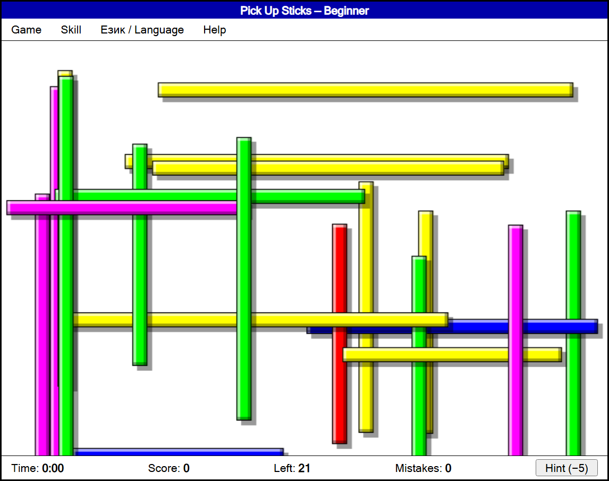
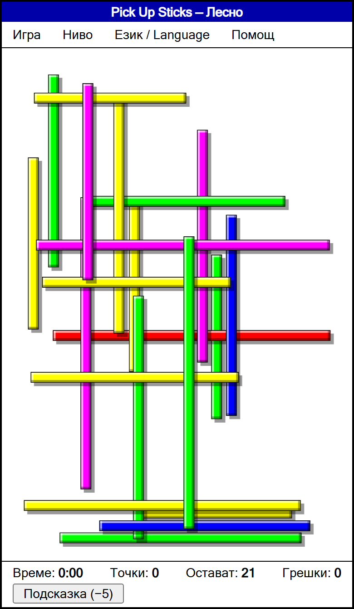

# 🥢 Pick Up Sticks

**The classic Windows 3.x dexterity game from 1991, rebuilt for the browser and playable on desktop and mobile.**

### [▶ Play online](https://svetlyobg.github.io/pick-up-sticks/)

[English](#english) · [Български](#български)

---

## English

A pile of coloured sticks has been dropped on the table. Pick them up one at a time, but only a stick with **nothing lying on top of it**. Take a pinned stick and you lose points.

### ✨ Features

- 🖥️ **Authentic Windows 3.1 look:** blue title bar, drop-down menus and flat bright sticks, just like the 1991 original
- 📱 **Works on phones:** the board scales to fit the screen and turns vertical in portrait mode, and touch has its own controls
- 🌗 **Shadows & 3D:** every stick casts a shadow on the sticks below it, so you can tell which one is on top
- ✏️ **Outline on hover:** a dashed outline traces the whole stick, including the parts hidden under others
- 💡 **Hint:** flashes the most valuable free stick, at a price
- 🔊 **Retro sound effects,** generated live with the Web Audio API
- 🌍 **Bulgarian and English:** picked automatically from your device language, or switch any time from *Език / Language*
- 💾 **Remembers your settings:** skill level, language, sound and visual aids
- 📦 **No installs or dependencies:** a single HTML file

### 🎮 How to play

| | Desktop | Phone |
|---|---|---|
| **See a stick** | Hover over it | Press and hold |
| **Pick it up** | Click | Lift your finger |
| **Change your mind** | Just move away | Slide your finger off the stick |

Clicking a stick that is **pinned** by another one counts as a mistake: **−5 points**.

### 🏅 Scoring

| Stick | Count (Advanced) | Points |
|---|:---:|:---:|
| 🟥 Red | 1 | **20** |
| 🟦 Blue | 4 | **10** |
| 🟪 Magenta | 8 | **5** |
| 🟩 Green | 12 | **3** |
| 🟨 Yellow | 16 | **2** |

A hint costs 5 points. When the table is clear, you get a rank based on your mistakes, from **Steady Hands** (no mistakes) to **Bull in a China Shop**.

### 📊 Skill levels

| Level | Sticks |
|---|:---:|
| Beginner | 21 |
| Intermediate | 31 |
| Advanced | 41 |

### 💻 Run it locally

There's nothing to build: download [`index.html`](index.html) and open it in any modern browser.

---

## Български

Купчина цветни пръчици е хвърлена на масата. Вдигай ги една по една, но само тези, върху които **не лежи друга пръчица**. Ако вземеш затисната пръчица, губиш точки.

### ✨ Възможности

- 🖥️ **Автентичен вид на Windows 3.1**, както в оригинала от 1991 г.
- 📱 **Работи на телефон:** дъската се побира в екрана и става вертикална в портретен режим
- 🌗 **Сенки и обем:** всяка пръчица хвърля сянка върху тези под нея и се вижда коя е отгоре
- ✏️ **Контур при посочване:** пунктирът показва цялата пръчица, дори частите ѝ под други
- 💡 **Подсказка:** показва най-ценната свободна пръчица (струва 5 точки)
- 🔊 **Ретро звуци**
- 🌍 **Български и английски:** според езика на устройството или от менюто *Език / Language*
- 💾 **Запомня настройките ти**

### 🎮 Как се играе

| | Компютър | Телефон |
|---|---|---|
| **Виж пръчицата** | Посочи я | Натисни и задръж |
| **Вдигни я** | Кликни | Пусни пръста |
| **Откажи се** | Премести мишката | Плъзни пръста встрани |

**Точки:** 🟥 червена 20 · 🟦 синя 10 · 🟪 лилава 5 · 🟩 зелена 3 · 🟨 жълта 2. Грешка или подсказка: −5.

**Нива:** Лесно (21 пръчици) · Средно (31) · Трудно (41).

---

Inspired by *Pick Up Sticks* for Windows 3.x (1991). Part of a collection of retro Windows game remakes. See also [Memory Blocks](https://svetlyobg.github.io/memory-blocks/).

